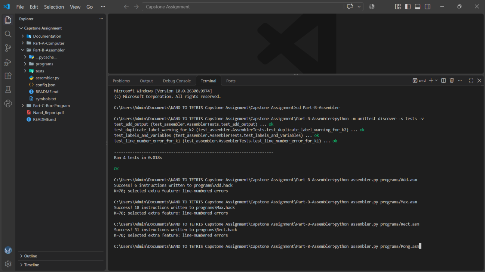
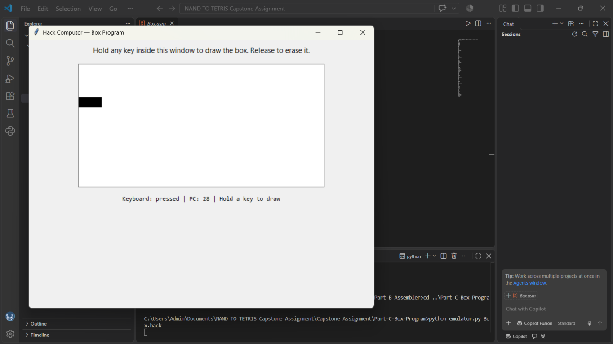
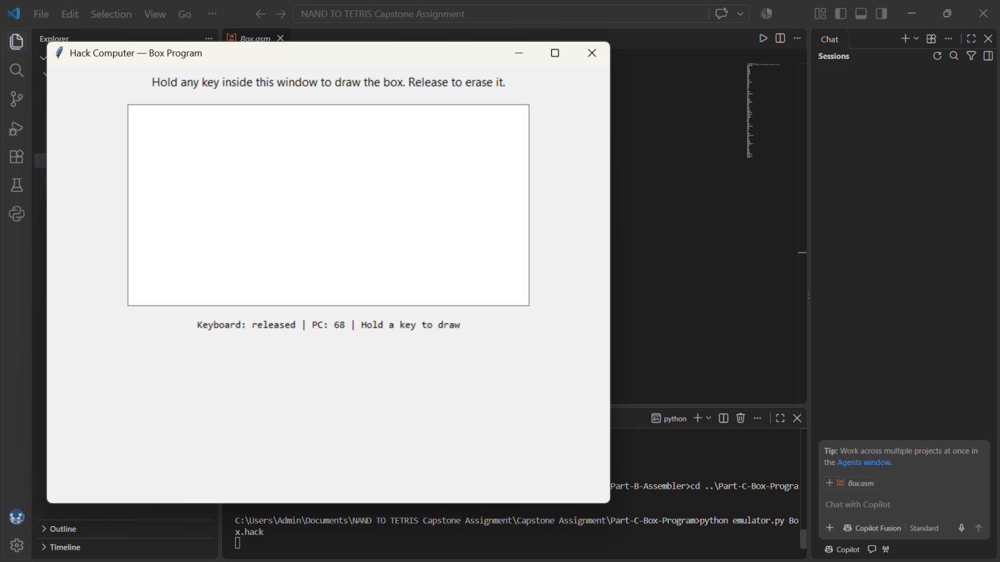

<!-- LAKSHAY ANAND • 2501730449 • PERSONAL ACADEMIC COPY -->

# Nand2Tetris Capstone Project Report
## Make the Hack Computer Draw a Box

**Student:** Lakshay Anand  
**University roll number:** 2501730449 ()  
**Personal number K:** 49  
**Course:** Nand-to-Tetris  
**Submission date:** 30 November 2026

## 1. Introduction and objectives

This capstone covers the Hack computer hardware, a two-pass Python assembler, and a Hack assembly program that draws a keyboard-controlled rectangle. The work is organised into three parts: CPU/Memory/Computer HDL integration, assembly-to-machine-code translation, and the personalised box program.

## 2. Personalisation

| Property | Value |
|---|---:|
| K | 49 |
| K mod 3 | 1 — line-numbered errors for invalid assembler input |
| K mod 4 | 1 |
| Box height | 20 screen rows |
| Words per row | 2 |
| Box width | 32 pixels |
| Starting row | 49 |
| First screen word | 17952 (`16384 + 32 × 49`) |

## 3. Part A — Hack computer hardware

`CPU.hdl` implements instruction decoding, register control, ALU operation, memory write control and program-counter updates. `Memory.hdl` connects RAM, screen-mapped memory and keyboard input. `Computer.hdl` integrates the CPU, instruction ROM and memory.

The supplied project archive contains these HDL files. The official course test scripts and comparison files were not included in the source archives, and no official Hardware Simulator pass is claimed here. Run `CPU.tst`, `Memory.tst`, `ComputerAdd.tst`, `ComputerMax.tst` and `ComputerRect.tst` against this exact project before reporting successful results.

## 4. Part B — Python assembler

The assembler uses two passes. The first pass strips comments and blank lines and records label addresses. The second pass translates A- and C-instructions, resolves symbols and allocates variables from RAM address 16. For K=49, the required extra feature is clear line-numbered errors for invalid instructions.

## 5. Part C — Personalised box

The program checks the keyboard-mapped address. While a key is pressed, it writes black pixel data to two consecutive screen words on each of 20 rows. When the key is released, it clears the same area.

The first screen word is `SCREEN + 32 × 49 = 17952`; the rectangle is 32 pixels wide and 20 rows high. `Box.asm` and `Box.hack` were regenerated for K=49 using the included generator and assembler.

## 6. Reference screenshots

The following images were extracted from the supplied reference report archive. They are included solely as visual examples of the workflow and expected presentation. They belong to the reference report's author and are **not evidence that Lakshay's implementation was executed or passed**.

### Assembler workflow reference

### Box visible reference

### Box cleared reference

## 7. Verification status

The archive includes source code and a personalised box program. The reference images above are illustrative only. Official HDL test outcomes, official CPU Emulator execution screenshots, and official assembler comparison results must be captured from Lakshay's own environment before claiming those checks as passed.

## 8. Conclusion

The project combines hardware description, symbol resolution, machine-code generation and memory-mapped input/output. The K=49 configuration determines both the assembler error-reporting feature and the box dimensions. The final submission should include genuine test evidence generated from this project and the full university roll number in the private copy where required.
